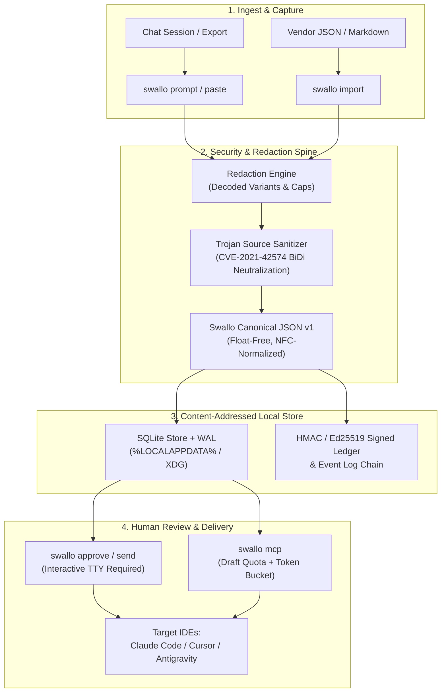

# swallo — Agent Context Handoff

[](https://github.com/raunaknayak12/swallo/actions/workflows/ci.yml)
[](https://github.com/raunaknayak12/swallo/actions/workflows/clean-install.yml)
[](https://github.com/raunaknayak12/swallo/actions/workflows/codeql.yml)
[](https://pypi.org/project/swallo/)
[](https://pypi.org/project/swallo/)
[](https://github.com/raunaknayak12/swallo/blob/main/LICENSE)
[](https://securityscorecards.dev/viewer/?uri=github.com/raunaknayak12/swallo)

Portable, reviewable handoff between any AI chat agent and any IDE with zero-network runtime isolation.

`swallo` is a local-first, zero-network Python package and security CLI tool designed to transport structured conversational and debugging context between AI chat agents (ChatGPT, Claude, Gemini) and agentic IDE environments (Claude Code, Cursor, Antigravity).

Context travels as an integrity-checked, schema-validated JSON "context packet" with cryptographic content addressing, deterministic canonicalization, explicit redaction bounds, Trojan Source sanitization, and zero network calls in the core runtime.

---

## Architecture Overview



---

## Installation

`swallo` is available on PyPI ([pypi.org/project/swallo/](https://pypi.org/project/swallo/)). Requires Python >= 3.11.

```bash
# Install swallo from PyPI (zero third-party runtime dependencies beyond Pydantic)
pip install swallo

# With optional extras:
pip install "swallo[mcp]"     # FastMCP server integration
pip install "swallo[sign]"    # Ed25519 passphrase signing via cryptography
pip install "swallo[tokens]"  # Token counting via tiktoken
pip install "swallo[dev]"     # Development, testing, and benchmark suite
```

### Dependency Isolation Guarantee
The core runtime strictly requires only `pydantic>=2.0.0` and the Python standard library. Optional dependencies (`mcp`, `cryptography`, `tiktoken`) are imported lazily on demand. Importing `swallo` emits zero warnings under `python -W error` and will never load optional modules into `sys.modules`.

---

## Quick Start

> For a complete 3-minute setup walkthrough for Claude Code, Cursor, and Antigravity IDEs, see the [Quickstart Guide](docs/QUICKSTART.md).

1. **Initialize the local store:**
   ```bash
   swallo init
   ```
2. **Verify environment health:**
   ```bash
   swallo doctor
   ```
3. **Capture context via structured paste:**
   ```bash
   swallo prompt --instructions > prompt.txt
   # Paste context into prompt.txt, then save:
   swallo save --file prompt.txt --target antigravity
   ```
4. **Inspect and approve the packet:**
   ```bash
   swallo show pkt_latest
   swallo approve pkt_latest --target antigravity
   ```
5. **Deliver to target IDE:**
   ```bash
   swallo send pkt_latest --target antigravity
   ```

---

## CLI Command Reference

`swallo` provides 23 structured subcommands:

| Command | Synopsis | Description |
|---|---|---|
| `swallo init` | `swallo init [--force]` | Initialize local store directory, database, HMAC key, and default config. |
| `swallo doctor` | `swallo doctor [--json]` | Diagnose environment, permissions, key health, and workspace roots. |
| `swallo prompt` | `swallo prompt [--instructions]` | Generate capture prompt template for chat assistants. |
| `swallo save` | `swallo save [--file F] [--target T]` | Ingest, redact, canonicalize, and store a new context packet. |
| `swallo import` | `swallo import <path> [--format FMT]` | Import vendor chat exports (ChatGPT, Claude, Gemini) securely. |
| `swallo merge` | `swallo merge <base> <incoming>` | Three-way merge two packets against a common base. |
| `swallo resolve` | `swallo resolve <pkt> [--accept OURS\|THEIRS]` | Resolve merge conflicts in a packet. |
| `swallo show` | `swallo show <pkt_id> [--raw] [--json]` | Inspect packet details, decisions, constraints, and provenance. |
| `swallo edit` | `swallo edit <pkt_id>` | Interactively edit packet fields with schema re-validation. |
| `swallo approve` | `swallo approve <pkt_id> [--target claude-code|cursor|antigravity|chat]` | Record cryptographic approval in local ledger (TTY required). |
| `swallo send` | `swallo send <pkt_id> [--to claude-code|cursor|antigravity|chat] [--format markdown]` | Materialize two-file delivery stub and handoff data file for IDE. |
| `swallo load` | `swallo load <pkt_id>` | Load packet into memory or inspect delivered state. |
| `swallo diff` | `swallo diff <pkt_a> <pkt_b>` | Show structural and field-level diff between two packets. |
| `swallo list` | `swallo list [--limit N] [--project P]` | List packets, drafts, approval status, and timestamps. |
| `swallo status` | `swallo status [--limit N] [--project P]` | Inspect store status and list stored context packets. |
| `swallo log` | `swallo log [--verify]` | Inspect audit event log and verify cryptographic hash chain. |
| `swallo staleness` | `swallo staleness <pkt_id> [--ack]` | Check git drift against HEAD; acknowledge critical drift. |
| `swallo drafts` | `swallo drafts [--clean] [--quota]` | Inspect and clean pending unapproved MCP draft packets. |
| `swallo breaker` | `swallo breaker [--reset]` | Inspect or reset the MCP save circuit breaker. |
| `swallo bench` | `swallo bench <run\|verify>` | Execute or verify deterministic benchmark suite. |
| `swallo mcp` | `swallo mcp [--transport stdio]` | Start the Model Context Protocol (MCP) server. |
| `swallo help` | `swallo help [command]` | Display detailed command help and argument descriptions. |
| `swallo version` | `swallo version [--json]` | Print tool version, supported schema versions, and runtime info. |

### Exit Codes
- `0`: Success.
- `1`: General application error.
- `2`: `UsageError` (invalid arguments, flags, or unknown command).
- `3`: `ValidationError` (schema or boundary violation).
- `4`: `RedactionBlockedError` (unredacted secret detected in fail-closed mode).
- `5`: `ConflictError` (unresolved merge conflict).
- `6`: `NotApprovedError` (attempting to consume unapproved context).
- `7`: `StaleContextError` (packet blocked by staleness drift policy).
- `8`: `IntegrityError` (corrupt database or broken event-log hash chain).
- `9`: `SecurityError` (path traversal, symlink escape, or forged approval).
- `10`: `RateLimitedError` (MCP session token bucket exhausted).
- `11`: `SessionPausedError` (MCP circuit breaker tripped after repeated blocked saves).
- `12`: `DraftQuotaExceededError` (draft count or storage quota exceeded).
- `13`: `UnregisteredProjectError` (workspace not registered in global store).

---

## Configuration Reference

Configuration is stored in `<store>/config.toml` (e.g. `%LOCALAPPDATA%\swallo\config.toml` on Windows, `~/.local/share/swallo/config.toml` on Linux).

```toml
[storage]
busy_timeout_ms = 5000     # SQLite WAL busy handler timeout
max_packet_bytes = 10485760 # 10MB packet payload limit
max_json_depth = 64        # Maximum nested JSON parsing depth

[redaction]
mode = "mask"              # "mask", "remove", or "fail_closed"
scan_decoded_variants = true
max_decode_depth = 3
max_decode_bytes = 65536
decode_timeout_ms = 200

[mcp]
enabled = true
token_bucket_rate = 30     # 30 requests per minute
token_bucket_burst = 10    # Burst allowance
draft_quota = 50           # Maximum unapproved drafts per project
circuit_breaker_threshold = 5 # Consecutive blocks before session pause

[approve]
signing = "hmac"           # "hmac" (default) or "passphrase" (Ed25519)
require_tty = true         # Invariant: agents cannot approve context
```

---

## MCP Integration

`swallo` provides standard Model Context Protocol (MCP) support over `stdio` via `python -m swallo mcp`. The server exposes:
- `save_context`: Store an unapproved draft packet (tier T1).
- `load_context` (and `get_context` alias): Retrieve approved context fenced against prompt injection.
- `verify_context`: Read-only verification of hash integrity, event-log HMAC chain, and ledger status.
- `list_contexts`: List summary metadata for stored packets.
- `merge_contexts`: Merge 1..N packets with conflict tracking.
- `diff`: Compare packets item-by-item.

In accordance with security invariant ADR-007, **no approve tool is exposed via MCP**. Human review and approval strictly requires the interactive CLI terminal.

Environment variables:
- `SWALLO_HOME` (primary): Set the local storage directory (defaults to `%LOCALAPPDATA%\swallo` on Windows, `~/.local/share/swallo` on Linux).
- `SWALLO_STORAGE_DIR`: Supported alias for `SWALLO_HOME`.

### Claude Code
Add to your project's `.mcp.json` or user-level config:
```json
{
  "mcpServers": {
    "swallo": {
      "command": "swallo",
      "args": ["mcp"]
    }
  }
}
```

### Cursor
Add to Cursor's MCP Settings (`Settings > Features > MCP`):
- **Name**: `swallo`
- **Type**: `command`
- **Command**: `swallo mcp`

### Antigravity
Add to `.gemini/antigravity/mcp/swallo.json` or your MCP server configuration:
```json
{
  "name": "swallo",
  "command": "swallo",
  "args": ["mcp"]
}
```

---

## Security Model & Structural Invariants

1. **Two-File Delivery**: Chat-derived context is written to isolated data files under `.swallo/handoff/`, leaving only a short pointer stub in rules files.
2. **Mandatory Interactive Approval**: Approval requires an interactive TTY. Agents cannot approve context.
3. **Deterministic Content Addressing**: All packets and items are addressed by SHA-256 hashes of their canonical JSON representations.
4. **Trojan Source Sanitization**: Bidirectional overrides, zero-width characters, and Unicode tag characters (CVE-2021-42574) are strictly stripped or neutralized.
5. **Circuit Breaker**: 5 consecutive blocked saves trip the MCP circuit breaker, pausing agent activity until reset by the human operator.

---

## Community & Code of Conduct

Swallo is an open, welcoming community. All participants are expected to adhere to our [Code of Conduct](CODE_OF_CONDUCT.md) (Contributor Covenant v2.1).

---

## License

This project is dual-licensed under:
- [MIT License](LICENSE-MIT)
- [Apache License, Version 2.0](LICENSE-APACHE)

at your option. See [LICENSE](LICENSE) for details.
