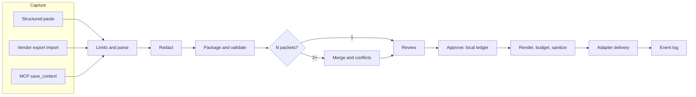

# swallo: A Reviewable, Local-First Architecture for Moving Context Between AI Agents

**Design paper, draft v0.1, 2026-10-25.** This paper explains the architecture and the reasoning behind it. It reports **no experimental results**: no benchmark has been run, and all claims about performance are stated as hypotheses to be tested under `BENCHMARKS.md`. Statements about external tools and products are from a limited survey and must be verified.

## Abstract

People increasingly think with one AI agent and act with another: they discuss a design in a chat app, ask a second model for a different view, then hand the result to an IDE agent. The handoff is usually manual copy-paste. We describe swallo, a pure-Python, local-first tool that turns a conversation into a validated, redacted, human-approved JSON *context packet*, merges several conversations with provenance and explicit conflict resolution, and delivers the result in the form each target expects. The design is shaped by three observations: chat apps do not expose conversations to outside programs, so capture must be layered; a handoff packet is an injection and leakage vector, so safety controls belong in the data path rather than around it; and a handoff tool should be evaluated by whether the next agent does better, not by memory-operation scores. We specify the packet model, the pipeline, the trust model, and an evaluation methodology designed so that any outcome, including no benefit, is reportable.

## 1. Introduction

### 1.1 The problem
A discussion held in one agent contains goals, decisions, constraints and unresolved questions. Reusing it elsewhere means either re-explaining it or pasting a transcript that is long, noisy and may contain secrets. Existing tools in this area appear to emphasize persistent memory for coding agents (examples surveyed in a limited sample: Open Memory Protocol, ContextStream, threadctx, baton-mcp, OpenMemory; verify against current documentation). We target the explicit act of *handing off*: user-triggered, inspectable, and bounded to a purpose.

### 1.2 Design goals
1. Support chat to IDE, chat to chat and IDE to IDE, each with 1..N source sessions.
2. Keep a single canonical, machine-checkable representation.
3. Operate locally with no account, container or model key.
4. Treat safety as a property of the pipeline: redaction, trust, review, integrity.
5. Make the workflow visible to the user.
6. Allow claims only as strong as the evidence.

### 1.3 Non-goals
Ambient memory, content moderation, cloud sync, and any claim that a receiving agent understood a packet.

## 2. Background and constraints

**Capture is the hard part.** Delivering text to an IDE agent over MCP is straightforward because both ends can be local. Getting a conversation *out* of a chat app is not: the apps do not push conversations to third-party programs. Realistic routes are asking the model itself to emit structured output, importing the vendor's account-data export, a remote connector that the model calls (hosted, plan-dependent), or scraping the page. Each trades fidelity, effort and trust differently (Section 5).

**Rules files are instruction channels.** IDE agents read files such as `CLAUDE.md`, `AGENTS.md` and `.cursor/rules` as guidance. Writing chat-derived text there elevates untrusted content into an instruction position (Section 7).

**Summaries lose information.** A model-written digest can omit a constraint without any signal. The architecture therefore keeps provenance, optional transcript spans, and a validation step, and records how each packet was captured.

## 3. System overview

One pipeline serves every flow. What differs is the capture adapter at the left and the delivery adapter at the right. Merge accepts a list of one or more packets, so a single-session handoff is the degenerate case.

## 4. The context packet

### 4.1 Contents
A packet holds a goal, items (decisions, constraints, open questions, artifact references), sources, optional repository state, conflict records and redaction counts. Each item carries provenance: which session and agent produced it and, when the capture method allows, character offsets into the stored transcript. Items may carry an optional `topic` and `value`, which let conflict detection be exact rather than linguistic.

### 4.2 What is deliberately outside the packet
- **Approval state.** Placing "approved" inside a portable file makes it forgeable. Approval is a local record keyed by the packet's hash and the target.
- **Trust.** A file cannot be trusted to describe its own trustworthiness. The tool assigns a trust tier on load from capture method and origin.
- **Raw transcripts and artifact bytes.** They live in a content-addressed object store, referenced by hash. This keeps packets small and removes path fields, which are a traversal risk.

### 4.3 Identity
A packet's identity is the SHA-256 of its canonical JSON, computed over a hashed form that leaves out volatile fields (the ID itself, creation time and capture timestamps), so identical content has the same hash whenever it was saved. IDs are derived from the hash, and packets contain no floating-point numbers, which keeps canonicalization exact. Any edit, including resolving a conflict, yields a new revision with a new hash. Approval therefore cannot survive tampering: changed content means a changed hash means no approval.

## 5. Capture: a layered strategy

| Method | Fidelity | Dependencies | Weakness |
|---|---|---|---|
| Structured-paste prompt | Model-written summary | None; works in any chat app | Model may omit or distort; user performs the copy step |
| Vendor export import | Raw transcript | User requests an account export | Bulk, sometimes slow; formats change; per-chat selection may be unavailable |
| IDE agent via MCP | Agent-written digest | Local MCP | Same omission risk as any model-written summary |
| Remote connector | Model-written | Hosted HTTPS endpoint, plan-dependent | Conflicts with local-first; availability varies |
| Browser extension | Raw, live | Separate JavaScript project | Fragile; page-reading permissions are a trust cost; excluded from this repository |

Every packet records its `capture_method`, shown at review. The framing is honest about the trade: raw exports preserve more, but model-written packets are available everywhere. The structured-paste prompt is the universal baseline precisely because it needs nothing from the chat vendor.

Whether each chat app currently supports connectors, which plans include them, and the present export formats are all subject to change and must be verified at build time.

## 6. Merging sessions

### 6.1 Why merge is first-class
Real work spans sessions: a brainstorm on one day, a refactor discussion on another. Merging is where silent errors enter: a later statement can contradict or supersede an earlier one, and a tool that chooses quietly will sometimes be wrong. Merge is available in every flow.

### 6.2 Procedure
1. Normalize items for comparison (Unicode form, whitespace, case folding).
2. Collapse exact duplicates and combine their provenance.
3. Detect near-duplicates by token-set similarity; collapse above a high threshold, show at review below it.
4. Detect conflicts: same topic with different values; override language ("ignore the earlier decision"); an optional negation heuristic.
5. Emit a draft with a conflict list. **A later item never supersedes an earlier one automatically.** The user resolves each conflict, producing a new revision, or delivers explicitly marked as unresolved.

### 6.3 Expected behavior and limits
The built-in detector is rule-based. We expect high precision and limited recall on unstructured text, because without `topic` and `value` keys most disagreements are linguistic. This is a hypothesis for Phase 2 evaluation, not a result. A `ConflictDetector` protocol allows user-supplied detectors, including model-assisted ones, off by default so that the core stays deterministic and key-free.

## 7. Trust and safety model

### 7.1 Threat view
Three flows carry risk: sensitive content leaving the machine, hostile content entering an agent's instructions, and fraudulent or accidental bypass of human review. The full model is in `Security.md`; its architectural consequences are:

1. **Redaction sits in the data path, before every write.** Transcripts, logs and error messages all pass through it, and the default is fail-closed. Placeholders use a keyed hash so that equal secrets map to equal placeholders without enabling guessing. Redaction is layered (patterns, entropy, optional external scanners, user deny-list) and presented in a preview. It cannot be proven complete; the evaluation reports measured recall against human labels.
2. **Two-file delivery.** Chat-derived content is written to a data file; the rules file receives only a fixed stub saying the content is reference data. The data is wrapped in a fence whose delimiter is random per render and checked not to occur in the content. This reduces, but does not eliminate, the chance an agent follows injected instructions; that depends on the model and is evaluated in a sandbox and reported as model-dependent.
3. **Approval is human and local.** The MCP server has no approve tool, because a tool an agent can call cannot be the human review step. Approvals are MAC'd with a local key and bound to hash and target.
4. **Tool-assigned trust tiers.** T0 (typed by the user), T1 (written by the user's IDE agent), T2 (pasted model output), T3 (imported or shared). Delivery policy follows the lowest tier among sources.
5. **Containment.** Packets reference objects by hash; repo files use one shared path resolver that rejects absolute paths, parent segments and symlink escapes. Importers enforce size, entry, ratio and depth limits and never use archive member names as paths.
6. **Guards on the agent-facing surface.** MCP saves are deduplicated, rate-limited per session, quota-bound and expiring; repeated blocked saves trip a circuit breaker that stores no content or fingerprints. Redaction scans bounded decoded variants and flags opaque blobs, and agents receive only minimal error detail. These controls raise the cost of evasion and runaway loops without pretending to prevent a determined attacker.
7. **Deterministic staleness gate.** MCP loads of packets with critical drift (a referenced file changed, deleted or renamed, or the commit no longer an ancestor of HEAD) are blocked rather than warned, because a warning depends on the model choosing to respect it. A human acknowledgment bound to the packet hash, HEAD and drifted-file hashes expires on any change.
8. **Launch-path integrity.** MCP setup is user-level with an absolute interpreter path, only registered project roots are served, and `doctor` flags workspace-level configurations and data files with no ledger record. An optional passphrase-signed approval tier raises the bar for forged approvals.

### 7.2 What the architecture does not promise
It does not fully defend against a compromised agent or attacker with the user's local privileges (the optional signed-approval tier raises the bar but cannot contain unrestricted file and shell access), does not guarantee that a model ignores injected text, does not guarantee redaction completeness, and cannot see what a receiving agent does with a packet.

## 8. Visibility and integrity

Users need to see that a handoff happened and what it contained. The tool keeps an append-only event log in which each entry's MAC covers the previous one, so edits or deletions are detectable by `swallo log --verify`. The log records metadata and hashes, never content, so it is not a second copy of sensitive data.

Event names are chosen to state only what the tool can know: `written` (a file was created), `served` (the MCP server returned a packet), `copied` (the user confirmed pasting). The log never says an agent "received" or "understood" anything. An optional packet-ID echo in briefings gives weak evidence that a packet was loaded, and is described as weak.

## 9. Storage and concurrency

SQLite (standard library) holds packets, approvals and events in WAL mode with immediate write transactions, so two agents saving at once cannot corrupt state. Objects are written to a temporary file in the destination directory, flushed, then renamed atomically. Directories and files use restrictive permissions where supported, and the store lives outside the project repository so that it cannot be committed by accident. A local random key supports the MACs and placeholder hashing; losing it invalidates old approvals, which is documented behavior.

## 10. Token budgeting and criticality

Targets have context limits and models are hurt by clutter. Rendering follows a priority order (goal, critical items, constraints, decisions, questions, references), estimates tokens, and trims from the bottom. Items marked `critical` are never trimmed; if they alone exceed the budget the operation fails with an explanation. This replaces silent loss with a visible error. The default estimator is a heuristic; an optional tokenizer extra improves accuracy for some model families and is approximate for others.

## 11. Repository awareness

A packet may record the git commit, a dirty flag and blob hashes of referenced files. On load, the tool compares these with the working tree and reports drifted files by name, or stays silent when nothing changed. This detects *file* change, not *meaning* change; a decision made obsolete without touching a referenced file is not detected. That limitation is documented.

## 12. Evaluation methodology

The evaluation is designed to be falsifiable and reproducible (`BENCHMARKS.md`).

- **Grounded data.** Messy, consented, human-labelled real sessions drive headline results; planted fixtures serve as regression tests.
- **Pre-registration and a sealed set.** Hypotheses, metrics and claim wording are committed first; the held-out set is run once.
- **Phase 1** (free, deterministic): redaction versus established scanners against human labels, latency, setup friction, determinism, staleness.
- **Phase 2:** fidelity of decisions and constraints, unsupported items, conflict handling with hard negatives.
- **Phase 3:** downstream agents continue real sessions under six conditions: no context, raw transcript, naive summary, competitor tools, this tool, a human-written note. Coding tasks are decided by test suites, avoiding model judges. Paired statistics, confidence intervals, repeated runs and at least two models are required before a "better than" claim.
- **Phase 4:** fair comparison against competitors on shared scenarios with published configurations.
- **Phase 5:** a within-subject human study.

A claims policy maps each evidence level to the strongest permitted sentence. In particular, token savings are never reported without success rates, since dropping information saves tokens trivially.

## 13. Limitations

1. Capture depends on external apps and may degrade as vendors change exports or connectors.
2. Model-written packets can be incomplete; validation catches structure, not content.
3. Rule-based conflict detection has limited recall on free text.
4. Injection mitigation is probabilistic and model-dependent.
5. Redaction recall is bounded by known patterns and the labelled corpus.
6. Targets may not load referenced data files automatically, trading some convenience for safety.
7. Phase 3 requires real model usage and its results are tied to the models, tasks and dates used.
8. A reproducible result is not automatically valid; independent review and contributed fixtures are part of the plan.
9. Guard thresholds (breaker, rate limits, quotas, TTL) are proposals that need tuning from real usage; set too loosely they miss abuse, set too tightly they obstruct legitimate work.
10. Several protections depend on IDE behavior swallo cannot control: workspace configuration handling, tool-approval prompts, MCP session identity and workspace roots.

## 14. Future work

Gemini and Claude importers and drift handling; optional remote mode with a scoped, opt-in relay; conflict-detector plugins; a separate-repository browser extension; a published results dashboard from contributed runs; a human study.

## 15. Conclusion

The central architectural claim is that a context handoff is a security-relevant data path, not a convenience feature, and should be built accordingly: capture is layered because no single route is reliable; safety controls (redaction, trust tiers, two-file delivery, local approval, integrity logging) are part of the pipeline; merging is a first-class operation that surfaces disagreement; and evidence of benefit comes from pre-registered, outcome-based tests rather than assertion. Whether the design actually helps the next agent is an empirical question this paper deliberately leaves open.

## Appendix A: Glossary

| Term | Meaning |
|---|---|
| Packet | Validated JSON record of goal, items, sources and metadata |
| Provenance | Which session, agent and (optionally) transcript span produced an item |
| Capture method | How a session entered the tool: `export`, `paste`, `connector`, `ide-agent`, `manual` |
| Trust tier | T0 to T3, assigned by the tool on load |
| Two-file delivery | Data file plus fixed stub in the rules file |
| Ledger | Local record of approvals bound to packet hash and target |
| Critical item | An item never trimmed by the token budget |
| Sealed set | Held-out evaluation data run once at the end |

## Appendix B: Items to verify before implementation

MCP SDK API; each IDE's rules-file and MCP behavior (including whether referenced data files are loaded); tokenizer offline behavior; vendor export formats and connector support by plan; PyPI trusted-publishing steps; competitor capabilities.
